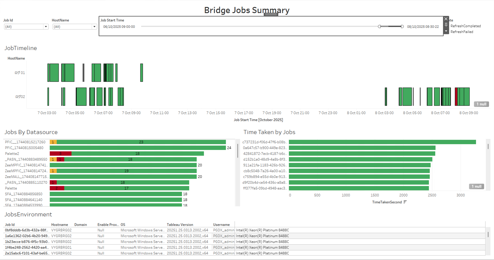
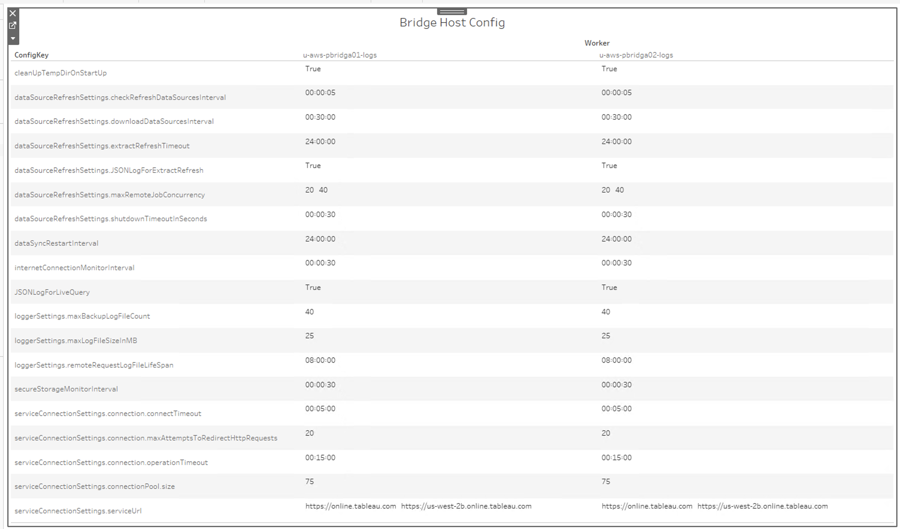
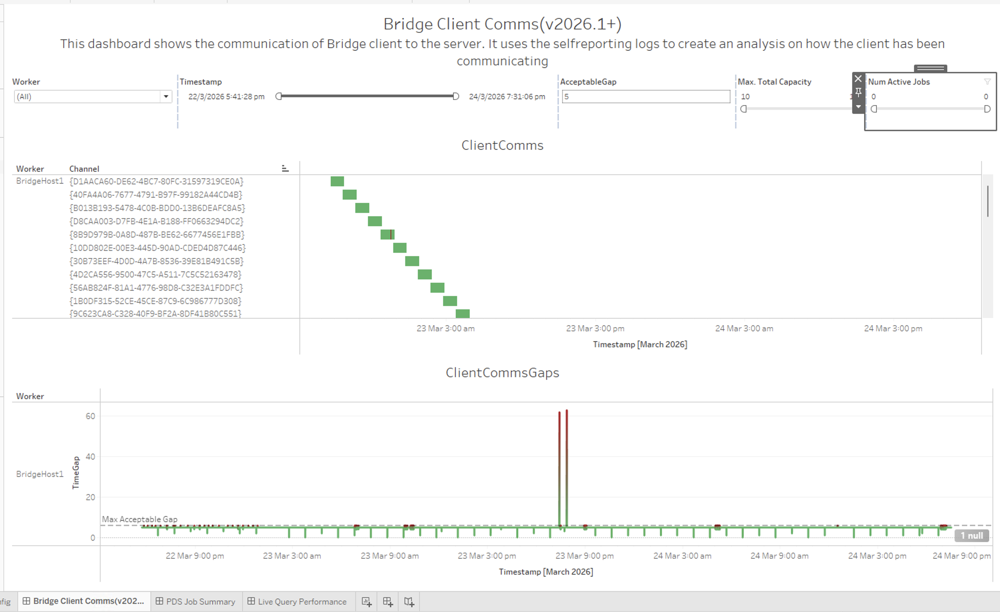
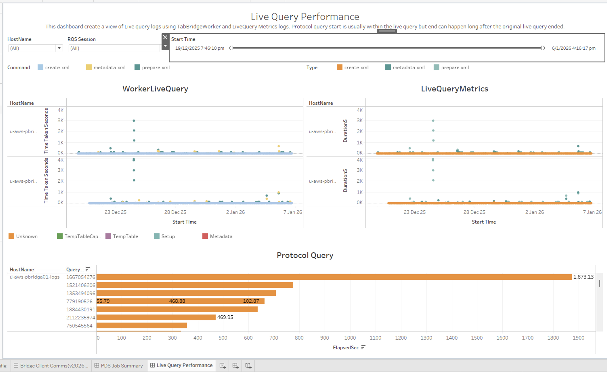
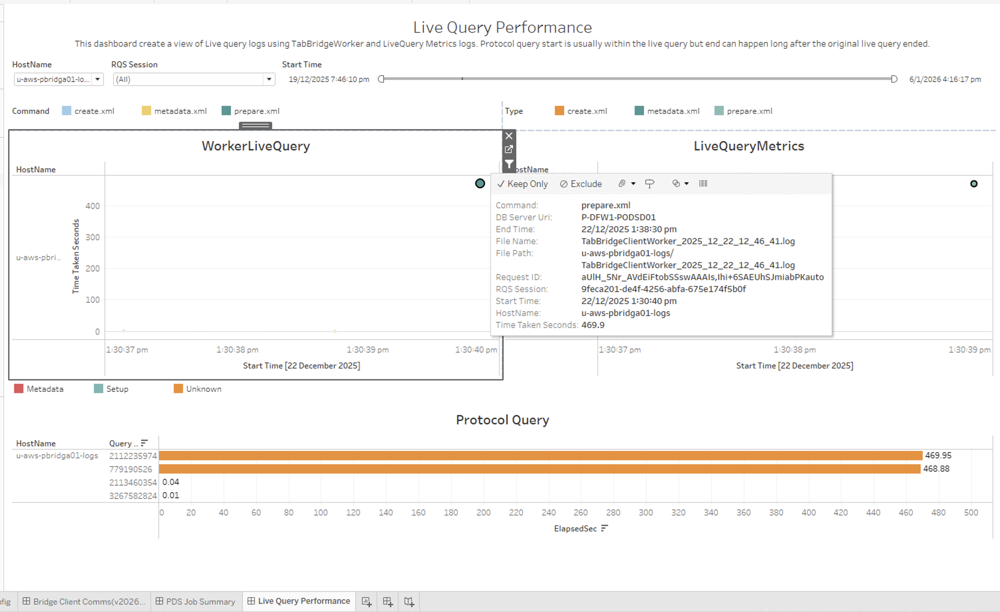

In this section:

* TOC
{:toc}


## What is it?
The Bridge workbook (`Bridge.twbx`) visualizes the logs written by Tableau Bridge clients (`TabBridgeClientWorker.log`, `TabBridgeClient.log` and `TabBridgeCliJob.log`). It helps you quickly understand the overall health of one or more Bridge clients: which refresh and live query jobs ran, how long they took, how the client was configured, and whether the client stayed connected to the server.

## Glossary of Important Terms to Understand Bridge Workbook Data and Dashboards

- **Job ID**: The LUID that identifies a single Bridge job. All job data in the workbook is linked to a Job ID, and one row is stored per Job ID.
- **Host Name**: The name of the folder that contains the Bridge log files for a client. See [Preparing your logs](#preparing-your-logs).
- **Live Query**: A query run by the Bridge client against a data source on behalf of the server. A live query is initiated by the `TabBridgeClientWorker` logs and can contain several protocol queries, each with a unique request ID.
- **RQS Session**: The remote query session that groups the live query metrics of a live query.

## When to use it?

- Investigate failing or slow Bridge refresh jobs and see how long each job spent queued, dispatched and running.
- Check whether one Bridge client (agent) is behaving differently from the others.
- Review the configuration of every Bridge client in the logset before investigating anything else.
- Verify that a Bridge client kept a connection to the server (Bridge 2026.1 and later).
- Understand what happened inside a live query, including the protocol queries it ran.

## Preparing your logs

Bridge logs do not have a standard archive layout like Tableau Server logs, so LogShark only extracts nested archives whose name contains **Bridge**. The following layouts are supported:

1. `LogArchive.zip` → `Bridge logs1.zip` → `Host1` → `TabBridgeClientWorker.log`, `TabBridgeClient.log`, `TabBridgeCliJob.log`
2. `LogArchive.zip` → `Bridge logs1.tar` → `Host1` → `TabBridgeClientWorker.log`, `TabBridgeClient.log`, `TabBridgeCliJob.log`
3. `LogArchive.tar` → `Bridge logs1.tar` → `Host1` → `TabBridgeClientWorker.log`, `TabBridgeClient.log`, `TabBridgeCliJob.log`

In each case, add one nested archive per Bridge host (for example `Bridge logs1` and `Bridge logs2` for `Host1` and `Host2`).

**Unexpected layouts:**

- If a nested archive does not have "Bridge" in its name (for example `LogArchive.zip` → `Host1.zip` → `TabBridgeClientWorker.log`), it is not extracted.
- If the log files sit in a generic folder (for example `LogArchive.zip` → `Bridge logs1.zip` → `Logs` → `TabBridge*.log`), they are processed, but the host name is shown as `Logs`. This makes it hard to tell hosts apart when the logset contains more than one.

## How to run it?

```
Logshark.exe <logsetpath> --plugins "Bridge"
```

## How to use it?

### Bridge Jobs Summary

This dashboard shows the jobs processed by the Bridge clients in the logset.



**Views:**
- ***JobTimeline***: Every Job ID per host, plotted from its start time to its end time and colored by job state (for example RefreshCompleted or RefreshFailed).
- ***Jobs By Datasource***: The number of jobs per data source, split by state. Useful for finding the most used data sources in Bridge and the ones that fail.
- ***Time Taken by Jobs***: A bar chart of the time taken in seconds by each Job ID, which makes long running jobs easy to spot.
- ***JobsEnvironment***: Details about the host that ran each job: host name, domain, OS, Tableau Bridge version, username and CPU details.

**Filters:**
- Job Id
- HostName
- Job Start Time
- State

**Use Cases:**
- Look up a specific job when you know its Job ID.
- Look at all the jobs of one host (agent) if it is behaving badly.
- Narrow down the time range to find jobs that ran around the time of an issue.

### Bridge Host Config

This dashboard shows the configuration of the Bridge client on every host in the logset, with one row per config key and one column per worker. It is the same configuration described in [Change the computer or site that Bridge syncs with](https://help.tableau.com/current/online/en-us/to_sync_change_computer_site.htm){:target="_blank"}.



**Use Cases:**
- Check that a client does not have an unusual configuration before you start investigating its logs.
- Compare the configuration of several hosts side by side to find settings that differ.

### Bridge Client Comms (Bridge 2026.1+)

This dashboard is only populated for Tableau Bridge 2026.1 and later, because the log line it relies on was added in that version.

It is based on the `SelfReportingStatusUpdate` log line, which the client writes every 5 seconds to report to the server that it is alive. If this line is missing for more than 5 seconds, the client could not communicate with the server and should open a new websocket to reconnect.



**Views:**
- ***ClientComms***: The communication channels used by each worker over time.
- ***ClientCommsGaps***: The time gap between consecutive self-reporting updates. Gaps above the "Max Acceptable Gap" line are highlighted in red.

**Filters:**
- Worker
- Timestamp
- AcceptableGap (the gap in seconds above which an update is treated as late; 5 by default)
- Max. Total Capacity
- Num Active Jobs

**Use Cases:**
- Find gaps in communication between a Bridge client and the server.
- Relate communication gaps to the number of active jobs and the client's capacity at that time.

### Bridge Live Query Performance

This dashboard shows the live queries run by the Bridge client. It is built from the `TabBridgeClientWorker` logs and the live query metrics logs. A protocol query usually starts within its live query, but it can end long after the live query itself ended.



**Views:**
- ***WorkerLiveQuery***: How long each live query lasted in the worker logs, colored by command (`create.xml`, `metadata.xml` or `prepare.xml`).
- ***LiveQueryMetrics***: The duration of the live query metrics, grouped by RQS session and colored by type.
- ***Protocol Query***: The elapsed time of the protocol queries that ran inside a live query. Tooltips show the query involved in each request.

**Filters:**
- HostName
- RQS Session
- Start Time

**How the views connect:**
- One live query can have several protocol queries, each with a unique request ID. Selecting a data point in *WorkerLiveQuery* shows the protocol queries that started within that live query, using the request ID, along with the matching data points in *LiveQueryMetrics*.
- *LiveQueryMetrics* does not carry the request ID, so it is linked to *WorkerLiveQuery* by RQS session. To see the whole RQS session, select any data point in *LiveQueryMetrics*. *WorkerLiveQuery* is then filtered to that session, and all three views show the full picture of what happened when the query ran.



**Use Cases:**
- Find the slowest live queries and protocol queries on a host.
- Follow a single live query through its protocol queries and RQS session.

## How the job data is extracted

The data is collected per Job ID. Once a Job ID is found, the following lines are scanned for status updates until `RefreshCompleted` is reached. FirstSeen and LastSeen are updated every time the Job ID is encountered.

### BridgeJobDetails (from `TabBridgeClientWorker` logs)

| Field                  | Notes                                                                                                         |
|------------------------|---------------------------------------------------------------------------------------------------------------|
| JobID                  | The LUID from lines containing `jobID:`, stored without braces or quotes.                                     |
| FirstSeen              | Timestamp when the Job ID is first encountered in the file.                                                   |
| LastSeen               | Timestamp when the Job ID is last encountered.                                                                |
| JobStartTime           | Timestamp of the line with `message-type: response-status` and `state: RefreshStarted`.                       |
| JobEndTime             | Timestamp of the line with `message-type: response-status` and `state: RefreshCompleted`.                     |
| AddingJobToQueueTime   | Timestamp of the line with `Adding remote job request to queue`.                                              |
| AddedJobToQueueTime    | Timestamp of the line with `Added remote job request to queue`.                                               |
| DispatchingJobTime     | Timestamp of the line with `Dispatching remote job request`.                                                  |
| CLIProcessLaunchTime   | Timestamp of the line with `Launching the CLI process`.                                                       |
| DataSourceUri          | The value after `data-source-uri`, when present.                                                              |
| ErrorType              | The numeric value from `msg: SendStatus` lines. The last available value is kept.                             |
| State                  | The result of the job.                                                                                        |
| RefreshType            | The value from lines containing `refresh-type` (usually `full`).                                              |
| TokenID                | The LUID from lines containing `Assigning token`.                                                             |
| RetryCount             | The numeric value from lines containing `retryCount`.                                                         |
| ProcessId              | The numeric value from lines containing `PID=`.                                                               |
| HostName               | The name of the folder containing the files. If the folder is called `Logs`, the host name is shown as `Logs`. |

### BridgeJobEnvironment (from `TabBridgeCliJob` logs)

| Field          | Notes                                                           |
|----------------|-----------------------------------------------------------------|
| CPUName        | CPU details.                                                    |
| Domain         | Domain name of the machine running the Bridge client.           |
| JobID          | Job ID used for the CLI job.                                    |
| Hostname       | Host name of the machine.                                       |
| OS             | Operating system of the machine.                                |
| ProcessId      | Process ID of the CLI job.                                      |
| StartTime      | Start time of the CLI job.                                      |
| Tableau Version| Tableau Bridge version installed.                               |
| Username       | User running the Bridge client. Can be a service account.       |
